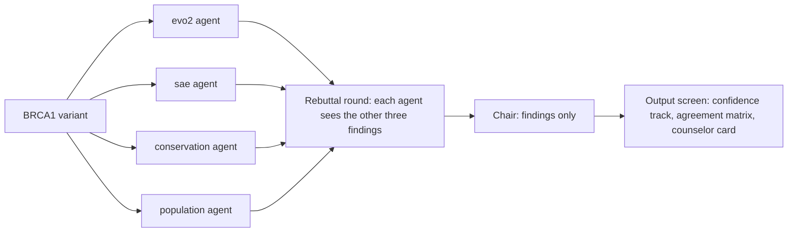

# GENIUS

A multi-agent panel that reviews BRCA1 variants of uncertain significance, built at a hackathon. The evidence agents, the rebuttal round and the chair call an LLM. Evo 2 7B scored the calibration and test splits on a GPU, and two baselines were evaluated on the held-out test split (see [Results](#results)). The panel itself has run only on three calibration-split variants, saved in `data/demo/panel_reports.json`, and has never been evaluated on the test split. The SAE agent is not built: it always reports unavailable.

## Problem

ACMG guidelines say no clinical decision should rest on a variant of uncertain significance, or VUS (Richards et al. 2015, Genet Med 17(5):405-424, doi:10.1038/gim.2015.30).

## Solution

A panel of LLM agents reviews one BRCA1 single-nucleotide variant. Each agent is restricted to one evidence type:

- `evo2`: log-likelihood delta (alt minus ref) from Evo 2 7B
- `sae`: planned, Goodfire SAE feature activations at the variant position on Evo 2 7B. No branch computes them yet, so the sae tool always reports unavailable. Branch `d` adds mock SAE values to its sample reports for UI work, and that is not on main.
- `conservation`: per-base conservation score at the position, from a local cached file
- `population`: gnomAD allele frequency, from a local cached file

In the rebuttal round each evidence agent sees the other three findings, never their tools, and may revise its verdict once with a reason. Both versions are kept. A chair agent then reads the findings, never the tools, and returns a call, the evidence that drove it, conflicts, an explicit "unresolved" flag, what test would settle it, and a plain-language summary.

A single agent with all four tools is the baseline for multi-agent against single-agent.

## Who it's for

Genetic counselors and lab variant curators. Patients read the summary the counselor hands them. The app never addresses patients directly.

## Architecture



Each evidence agent imports only its own tool module. The orchestrator removes the Findlay answer-key fields before any agent sees the variant, and the chair receives the variant ID and two lists of findings, nothing else. `tests/test_isolation.py` enforces both.

## Running locally

You need [uv](https://docs.astral.sh/uv/). It fetches Python 3.11 if you don't have it.

```bash
uv venv --python 3.11
uv pip install -e ".[dev]"
```

Run the tests:

```bash
.venv/Scripts/python -m pytest -q   # Windows
.venv/bin/python -m pytest -q       # macOS and Linux
```

Tests never reach the network. An autouse fixture in `tests/conftest.py` blocks socket connections and DNS lookups, clears the API variables, and points the data and run directories at a temporary folder.

Serve the API and the page:

```bash
.venv/Scripts/python -m uvicorn vus_panel.api:app --reload   # Windows
.venv/bin/python -m uvicorn vus_panel.api:app --reload       # macOS and Linux
```

Open http://127.0.0.1:8000. The page opens on the three saved real reviews in `data/demo/` (`GET /demo`), and "Load sample reports" shows the five mock reports in `data/fixtures/` under a "Sample data" banner. The review form posts a variant to `POST /review`, which runs the four agents, the rebuttal round and the chair. Without `ANTHROPIC_API_KEY` or `ANTHROPIC_MODEL`, no agent gives a verdict: one whose tool returned evidence reports unavailable, and the call is `unresolved`. The evo2 agent also needs `EVO2_SCORES_DIR` (for variants in a stored run) or `EVO2_BACKEND_URL`, the conservation and population agents need the `data/cache/` files that `scripts/` builds, and the sae agent always reports unavailable. The question box sends questions about the panel to `POST /explain`.

Configuration comes from environment variables. Copy `.env.example` to `.env` and fill it in. `.venv/Scripts/python -m vus_panel.serve` (or `.venv/bin/python`) loads `.env` and starts the server on :8000. A value already set in your shell wins, and only variable names are printed. Plain `uvicorn` does not read `.env`.

| Variable | Used for |
| --- | --- |
| `ANTHROPIC_API_KEY` | LLM calls by the agents, the chair, the single-agent baseline and `POST /explain` |
| `ANTHROPIC_MODEL` | the model name, read at runtime and never hardcoded |
| `EVO2_BACKEND_URL` | URL of the Evo 2 scoring service (`scoring/service.py`) on the GPU instance. The sae tool sends it no request |
| `EVO2_SCORES_DIR` | a stored Evo 2 run directory, or a folder of them, such as `runs/` on the machine that scored the splits. The evo2 tool reads a variant's stored delta from here before it tries `EVO2_BACKEND_URL` |

Small reference files that every teammate needs are committed in `data/reference/`. Each one has an entry in `data/reference/MANIFEST.json` with its path, source URL, release or version, download date, genome build, license as stated by the source, sha256, size in bytes and owner branch. `tests/test_reference_data.py` fails if a file has no entry, a checksum or size doesn't match, a file is over 50 MiB, or an entry has an empty source or license. The repo is public, so add only files whose license allows public redistribution, and never model weights, SAE weights or genome-wide files. Full-size downloads stay in the gitignored `data/raw/` and `data/cache/`.

Make the calibration/test split once the Findlay file is in place. Put `41586_2018_461_MOESM3_ESM.xlsx` from Findlay et al. 2018 in `data/raw/`. Nothing in this repo downloads it. It is not committed: no reuse license for it was found, and the repo is public.

```bash
.venv/Scripts/python -m vus_panel.eval.split   # Windows
.venv/bin/python -m vus_panel.eval.split       # macOS and Linux
```

Running it again needs `--force` to overwrite existing split files.

Score a set of real (non-mock) reports on the test split:

```bash
.venv/Scripts/python -m vus_panel.eval.run_eval --reports path/to/reports.json --system panel   # Windows
.venv/bin/python -m vus_panel.eval.run_eval --reports path/to/reports.json --system panel       # macOS and Linux
```

## Repo layout

```
README.md
CLAUDE.md, AGENTS.md      instructions for Claude Code and Codex
pyproject.toml, uv.lock
.env.example              ANTHROPIC_API_KEY, ANTHROPIC_MODEL, EVO2_BACKEND_URL, EVO2_SCORES_DIR (empty)
.gitignore                .env, data/raw/, data/cache/, runs/, Python tooling
.gitattributes            data/reference/ and data/splits/ files are stored and checked out byte for byte
src/vus_panel/
  schemas.py              the contracts below
  config.py               repo paths and env getters
  llm.py                  Anthropic client; model name from ANTHROPIC_MODEL
  tools/                  one module per evidence source: evo2, sae, conservation, population
  agents/                 evo2, sae, conservation, population, chair, single_agent, and the shared _common.py and _interpret.py
  orchestrator.py         four agents, one rebuttal round, then the chair
  explain.py              answers questions about the panel for POST /explain
  scoring/                Evo 2 scoring: wire contracts, the CPU client, and the GPU backend and service
  eval/                   split.py, metrics.py, run_eval.py, the timing pilot (pilot*.py, findlay_validation.py),
                          score_split.py, and the evo2_alone.py and logistic_baseline.py baselines with their shared _baseline.py
  api.py                  GET /, POST /review, GET /fixtures, GET /demo, POST /explain
  serve.py                loads .env, then starts the API
scripts/                  build and check the phyloP and gnomAD caches, and build calibration_refs.json, in data/cache/
web/index.html            the output screen: vanilla JS, inline SVG, no build step
data/splits/              committed variant-ID lists, split_meta.json and pilot20.json
data/fixtures/            mock PanelReports for UI work only
data/demo/                saved real panel reviews the page opens with
data/reference/           small tracked reference files, each listed with its sha256 in MANIFEST.json
docs/                     findlay-evo2-pilot.md (Evo 2 pilot and split scoring), mermaid-diagram.png, and
                          results/ (committed run records and metrics)
runs/                     run outputs with config, seed, git commit, timestamp (not committed)
tests/
.claude/agents/           Claude Code subagents: evidence-models and orchestration-eval (d), evidence-data (a), demo-pitch (k), frontend (m), the checker, and maker
.claude/hooks/            the checker's Bash guard
.codex/agents/            Codex configuration for the same roles
```

## Contracts

The source of truth is `src/vus_panel/schemas.py`, tested in `tests/test_schemas.py`. Every model forbids extra fields and is frozen.

- **Variant**: `chrom`, `pos`, `ref`, `alt`, `genome_build` (required, `"GRCh37"` or `"GRCh38"`), optional `hgvs_c`, `findlay_function_class`, `findlay_score`. `ref` and `alt` are single bases from ACGT and differ. `chrom` accepts `17` or `chr17` and stores `17`. The ID is `BUILD-CHROM-POS-REF-ALT`, for example `GRCh37-17-100-A-G`.
- **AgentFinding**: `agent`, `variant_id`, `status` (`"ok"`, `"unavailable"` or `"error"`), `verdict` (`"damaging"`, `"tolerated"`, `"uncertain"` or null), `raw_values`, `rationale`, `sources`. `verdict` is null and `raw_values` is empty unless status is `"ok"`. Added here: an ok finding needs a verdict, and the optional `revision_reason` holds the rebuttal round's reason. The optional `what_would_change_my_mind` holds, for an ok finding only, the evidence that would change its verdict; it is non-empty when set and never mentions ClinVar.
- **PanelReport**: `variant_id`, `call` (`"likely_damaging"`, `"likely_tolerated"` or `"unresolved"`), `confidence` (in [0, 1] or null), `calibrated`, `driving_agents`, `conflicts`, `what_would_settle_it`, `counselor_summary`, `patient_summary`, `findings_initial`, `findings_after_rebuttal`, `mock`. Added here:
  - findings match the report's variant, and both finding lists cover the same agents
  - a resolved call needs a confidence and at least one driving agent, and driving agents had status ok after rebuttal
  - an unresolved call has null confidence and `calibrated: false`
  - an initial finding has no `revision_reason`
  - a non-ok finding can't gain a verdict in rebuttal
  - an ok finding keeps its `raw_values` and `sources` through rebuttal
  - a changed verdict, or an ok finding withdrawn in rebuttal, carries a `revision_reason`
- **RunRecord**: `run_id`, `git_commit`, `config`, `seed`, `started_at` (timezone-aware), `variant_ids`, `outputs_path`.
- **Tool isolation**: each agent receives only its own tool functions. A test fails if any agent module imports another agent's tool module, directly or through a shared helper, and another checks that the chair receives findings only.
- **Answer key**: every agent `run()` and tool entry point raises `AnswerKeyError` on a Variant with `findlay_function_class` or `findlay_score` set, and `POST /review` rejects a body that includes either field, even as null, with a 422 that names it.

Tools return a `ToolResult` with the same rule: no values unless status is `"ok"`. A missing backend or data file gives `"unavailable"` with a message naming what's missing and who owns it. A cache that exists only for the other genome build gives `"error"`, because there is no liftover step.

## Branch ownership

| Branch | Owner | Workstream | Subagent |
| --- | --- | --- | --- |
| d | Devansh | Evo 2/SAE scoring service, Findlay loader and splits, orchestrator, `chair.py`, `api.py`, single-agent baseline, Evo 2-alone and logistic baselines, eval | evidence-models, orchestration-eval |
| a | Teammate A | phyloP and gnomAD caches for the BRCA1 region in GRCh37, with a five-position hand spot-check | evidence-data |
| k | Teammate K | Step 2 vulnerability table from FDA labels, three demo variants from the calibration split, pitch deck and demo script | demo-pitch (owns `docs/demo/`, no code) |
| m | Teammate M | Output screen against fixtures, report card renamed for tumor boards, second-hit input field | frontend (owns `web/` only) |

Merge rule: PR into main, and run the checker subagent on the diff before merging.

Each role subagent file in `.claude/agents/` lists the files it owns, and everything else is read-only for it.

Shared files, read-only for every subagent:

- `src/vus_panel/__init__.py`, `src/vus_panel/agents/__init__.py`, `src/vus_panel/tools/__init__.py`
- `src/vus_panel/config.py`, `src/vus_panel/llm.py`, `src/vus_panel/schemas.py`, `src/vus_panel/agents/_common.py`
- `tests/conftest.py`, `tests/_factories.py`, `tests/test_isolation.py`, `tests/test_answer_key_guard.py`, `tests/test_schemas.py`, `tests/test_llm.py`, `tests/test_network_guard.py`, `tests/test_checker_guard.py`
- `pyproject.toml`, `.gitignore`, `.gitattributes`, `.env.example`, `README.md`, `.claude/`

Change these only in a PR that every affected owner has reviewed.

## Evaluation plan

- **Answer key**: the saturation genome editing scores for 3,893 BRCA1 SNVs from Findlay et al. 2018 (Nature 562(7726):217-222, doi:10.1038/s41586-018-0461-z), as used in [NVIDIA's Evo 2 zero-shot BRCA1 notebook](https://docs.nvidia.com/bionemo-framework/2.5/user-guide/examples/bionemo-evo2/zeroshot_brca1/). Following that notebook, LOF is the positive class and FUNC plus INT are negative. Positions are hg19, so GRCh37.
- **Split**: `eval/split.py` assigns variant IDs to calibration and test with seed 0, stratified by function class. The calibration fraction defaults to 0.2 and is a CLI flag. Only ID lists and a metadata file (seed, counts, the source file's sha256) are committed to `data/splits/`.
- **Systems compared on the test split**: the panel, the single-agent baseline, Evo 2 alone (the zero-shot delta, scored as minus delta as in the notebook, `eval/evo2_alone.py`), and a logistic regression on the Evo 2 delta, phyloP and gnomAD presence and frequency, fit on the calibration split only (`eval/logistic_baseline.py`).
- **Discrimination**: AUROC on resolved variants, always reported together with coverage, the fraction not unresolved. A system can't look better by abstaining without that showing up in coverage.
- **Calibration check**: reliability bins and expected calibration error on the test split. Any calibration is fit on the calibration split only, and a report sets `calibrated: true` only after that.
- **Spread**: any standard deviation, for example across seeds, uses ddof=1.
- **Guards**: `eval/run_eval.py` refuses records with `mock: true`, reports for variants outside the test split, test-split reports that mention ClinVar (the name, VCV, RCV or SCV accessions, or CLN* VCF tags), a report set that covers only part of the test split unless `--allow-partial` is given, and a `--seed` or Findlay file that doesn't match `split_meta.json`. It records the test-split size, the number evaluated and the sha256 of `test.txt`. Each run writes `runs/<run_id>/run_record.json` (config, seed, git commit, timestamp) and `metrics.json`.

## What is mocked and what is real right now

Real, on main:
- **The split.** `eval/split.py` built it from the real Findlay workbook, which stays out of git. The ID lists and `split_meta.json` are committed in `data/splits/`.
- **Evo 2 7B scores for the calibration and test splits**, computed on a GPU by `eval/score_split.py`. The per-variant scores stay in the gitignored `runs/`, except that the three demo reviews in `data/demo/` show the stored deltas for their own variants. The two run records are in `docs/results/`. With `EVO2_SCORES_DIR` pointing at those runs, the evo2 tool reads the scores back.
- **The conservation and population tools.** They read phyloP 100-way and gnomAD v2.1.1 caches that `scripts/` builds in the gitignored `data/cache/`, so a fresh clone has neither until the scripts run.
- **The LLM layer.** The evidence agents, the rebuttal round, the chair, the single-agent baseline and `POST /explain` call the model named in `ANTHROPIC_MODEL`. Without a key or a model, no agent gives a verdict: one whose tool returned evidence reports unavailable, and the chair returns `unresolved`.
- **Two test-split baselines**, Evo 2 alone and a logistic regression, evaluated through `run_eval`. See [Results](#results).
- **Three live panel reviews** of calibration-split variants, saved in `data/demo/panel_reports.json`. The page opens on them.

Not built:
- **The SAE agent.** There is no SAE backend, so the sae tool always returns unavailable and the agent never gives a verdict.
- **Panel and single-agent evaluation.** Neither has been run through `run_eval` on the test split.
- **Calibrated panel confidence.** The chair's confidence is the model's own judgement, so panel reports carry `calibrated: false`.

Mock: `data/fixtures/panel_reports.json` holds five reports, all `mock: true`, for UI work. "Load sample reports" shows them under a "Sample data" banner, and `run_eval` refuses them. Three of the five give the SAE agent a verdict. That is placeholder text with no values behind it, not SAE output.

## Known risks

- **GPU access for evo2 and sae**: Evo 2 7B needs an FP8-capable GPU. The calibration and test splits are already scored, and with `EVO2_SCORES_DIR` pointing at those runs the evo2 tool reads the stored scores without a GPU. The runs stay in the gitignored `runs/`, so on any other machine, or for a variant outside the splits, evo2 needs a live backend at `EVO2_BACKEND_URL`. The sae agent has no backend at all, so the panel has at most three evidence types, not four.
- **ClinVar leakage**: ClinVar must not be an input for any test-split variant. `run_eval` refuses findings that cite it, but an LLM may still recall ClinVar classifications for well-known BRCA1 variants from training, and a source check can't catch that.
- **Genome-build mismatch**: Findlay positions are GRCh37, and some gnomAD releases are GRCh38. There is no liftover step, so the tools return an error instead of comparing positions across builds, and the page draws one track per build.
- **Uncalibrated confidence**: a confidence an LLM states is not a probability. Reports carry `calibrated: false` until a calibration is fit on the calibration split, and the page draws those points as hollow rings.

## Results

Every number in this section comes from a committed file: the split metadata in `data/splits/`, and the run records and metrics copied into `docs/results/`. The run folders themselves stay in the gitignored `runs/`. Nothing in `docs/results/` holds per-variant Findlay scores, function classes or Evo 2 deltas. The only per-variant Evo 2 values committed anywhere are in the three demo reviews in `data/demo/panel_reports.json`, for their calibration-split variants.

### Split

From [`data/splits/split_meta.json`](data/splits/split_meta.json): 779 calibration variants (`n_calibration`) and 3,114 test variants (`n_test`), 3,893 in all (`n_calibration` + `n_test`).

### Frozen before scoring

- The split was written at 2026-10-31 19:35:28 UTC (`created_at` in [`split_meta.json`](data/splits/split_meta.json)).
- Evo 2 scoring started at 2026-11-01 00:16:59 UTC for the calibration split and at 2026-11-01 00:30:31 UTC for the test split (`sessions[0].started_at` in the [calibration](docs/results/20261101T001659Z-calibration-24f24f1172b3/run_record.json) and [test](docs/results/20261101T003031Z-test-54501907591e/run_record.json) run records).

### Evo 2 7B scoring

| Split | Run record | Final outcomes (`sessions[0].scored`) | IDs in split (`selection.n_variants`) | Commit (`code.git_commit`) | Working tree (`code.dirty`) |
| --- | --- | ---: | ---: | --- | --- |
| Calibration | [20261101T001659Z-calibration-24f24f1172b3](docs/results/20261101T001659Z-calibration-24f24f1172b3/run_record.json) | 779 | 779 | `b13e463` | clean (`false`) |
| Test | [20261101T003031Z-test-54501907591e](docs/results/20261101T003031Z-test-54501907591e/run_record.json) | 3,114 | 3,114 | `b13e463` | clean (`false`) |

Each run finished in one session, with top-level `state` "completed" and `error` null. `scored` counts every final outcome, and a backend error about the variant also counts as final. The records hold no separate error or retry count. Every test variant does have a delta: the Evo 2-alone evaluation below resolved all of them (`coverage` 1.0).

### Test-split evaluation

Scored by `eval/run_eval.py` with LOF positive and FUNC plus INT negative.

| System | AUROC (`auroc_resolved`) | Coverage (`coverage`) | Evaluated (`n_evaluated`) | Test split (`n_test_split`) | Run ID | Commit (`git_commit`) |
| --- | ---: | ---: | ---: | ---: | --- | --- |
| Evo 2 alone | 0.872 | 1.0 | 3,114 | 3,114 | `evo2_alone-20261101T165910Z` ([metrics](docs/results/evo2_alone-20261101T165910Z/metrics.json), [run record](docs/results/evo2_alone-20261101T165910Z/run_record.json)) | `53e033b` |
| Logistic baseline | 0.890 | 1.0 | 3,114 | 3,114 | `logistic_baseline-20261101T165922Z` ([metrics](docs/results/logistic_baseline-20261101T165922Z/metrics.json), [run record](docs/results/logistic_baseline-20261101T165922Z/run_record.json)) | `53e033b` |

Both runs scored the same `test.txt`, sha256 `a8c4ef203397af385521c41078055b8aef7f48502f52526714927d44321ed348` (`test_split_sha256` in each `metrics.json`), from a clean tree (`config.git_dirty` false in each run record).

- The logistic baseline's 0.018 lead over Evo 2 alone was not significance-tested.
- Evo 2 alone turns minus delta into a rank so `run_eval` has a probability to read. The reliability bins and ECE in its `metrics.json` therefore mean nothing, and they are not reported here.
- The panel and the single-agent baseline were never evaluated on the test split.
