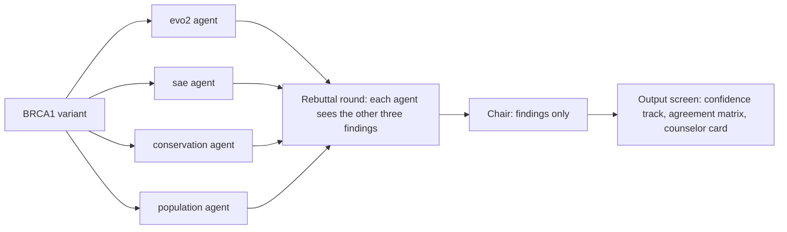

# GENIUS

A multi-agent panel that reviews BRCA1 variants of uncertain significance. This repo is a hackathon scaffold: the contracts, stubs and wiring are in place, no model agent is implemented, and there are no results yet.

## Problem

Almost one in five genetic tests returns a variant of uncertain significance, or VUS (citation needed), and patients often read it as high cancer risk even though ACMG guidelines say no clinical decision should rest on a VUS (Richards et al. 2015, Genet Med 17(5):405-424, doi:10.1038/gim.2015.30).

## Solution

A panel of LLM agents reviews one BRCA1 single-nucleotide variant. Each agent is restricted to one evidence type:

- `evo2`: log-likelihood delta (alt minus ref) from Evo 2 7B
- `sae`: Goodfire SAE feature activations at the variant position on Evo 2 7B
- `conservation`: per-base conservation score at the position, from a local cached file
- `population`: gnomAD allele frequency, from a local cached file

In the rebuttal round each evidence agent sees the other three findings, never their tools, and may revise its verdict once with a reason. Both versions are kept. A chair agent then reads the findings, never the tools, and returns a call, the evidence that drove it, conflicts, an explicit "unresolved" flag, what test would settle it, and a plain-language summary.

A single agent with all four tools is the baseline for multi-agent against single-agent.

## Who it's for

Genetic counselors and lab variant curators. Patients read the summary the counselor hands them. The app never addresses patients directly.

## Architecture



Each evidence agent imports only its own tool module. The orchestrator removes the Findlay answer-key fields before any agent sees the variant, and the chair receives the variant ID and two lists of findings, nothing else. `tests/test_isolation.py` enforces both.

## Running locally

You need [uv](https://docs.astral.sh/uv/). It fetches Python 3.11 if you don't have it.

```bash
uv venv --python 3.11
uv pip install -e ".[dev]"
```

Run the tests:

```bash
.venv/Scripts/python -m pytest -q   # Windows
.venv/bin/python -m pytest -q       # macOS and Linux
```

Tests never reach the network. An autouse fixture in `tests/conftest.py` blocks socket connections and DNS lookups, clears the API variables, and points the data and run directories at a temporary folder.

Serve the API and the page:

```bash
.venv/Scripts/python -m uvicorn vus_panel.api:app --reload   # Windows
.venv/bin/python -m uvicorn vus_panel.api:app --reload       # macOS and Linux
```

Open http://127.0.0.1:8000. "Load fixtures" shows the five mock reports under a MOCK DATA banner. The review form posts a variant to `POST /review`, which returns `call: "unresolved"` with four unavailable findings until the agents are implemented.

Configuration comes from environment variables. Copy `.env.example` to `.env` and fill it in. `.venv/Scripts/python -m vus_panel.serve` (or `.venv/bin/python`) loads `.env` and starts the server on :8000. A value already set in your shell wins, and only variable names are printed. Plain `uvicorn` does not read `.env`. The page opens on the saved real reviews in `data/demo/`.

| Variable | Used for |
| --- | --- |
| `ANTHROPIC_API_KEY` | agent LLM calls |
| `ANTHROPIC_MODEL` | the model name, read at runtime and never hardcoded |
| `EVO2_BACKEND_URL` | URL of the Evo 2 and SAE scoring service on the Brev instance |

Small reference files that every teammate needs are committed in `data/reference/`. Each one has an entry in `data/reference/MANIFEST.json` with its path, source URL, release or version, download date, genome build, license as stated by the source, sha256, size in bytes and owner branch. `tests/test_reference_data.py` fails if a file has no entry, a checksum or size doesn't match, a file is over 50 MiB, or an entry has an empty source or license. The repo is public, so add only files whose license allows public redistribution, and never model weights, SAE weights or genome-wide files. Full-size downloads stay in the gitignored `data/raw/` and `data/cache/`.

Make the calibration/test split once the Findlay file is in place. Put `41586_2018_461_MOESM3_ESM.xlsx` from Findlay et al. 2018 in `data/raw/`. Nothing in this repo downloads it. It is not committed: no reuse license for it was found, and the repo is public.

```bash
.venv/Scripts/python -m vus_panel.eval.split   # Windows
.venv/bin/python -m vus_panel.eval.split       # macOS and Linux
```

Running it again needs `--force` to overwrite existing split files.

Score a set of real (non-mock) reports on the test split:

```bash
.venv/Scripts/python -m vus_panel.eval.run_eval --reports path/to/reports.json --system panel   # Windows
.venv/bin/python -m vus_panel.eval.run_eval --reports path/to/reports.json --system panel       # macOS and Linux
```

## Repo layout

```
README.md
pyproject.toml
.env.example              ANTHROPIC_API_KEY, ANTHROPIC_MODEL, EVO2_BACKEND_URL (empty)
.gitignore                .env, data/raw/, data/cache/, runs/, Python tooling
.gitattributes            data/reference/ files are stored and checked out byte for byte
src/vus_panel/
  schemas.py              the contracts below
  config.py               repo paths and env getters
  llm.py                  Anthropic client; model name from ANTHROPIC_MODEL
  tools/                  one module per evidence source: evo2, sae, conservation, population
  agents/                 evo2, sae, conservation, population, chair, single_agent
  orchestrator.py         four agents, one rebuttal round, then the chair
  eval/                   split.py, metrics.py, run_eval.py
  api.py                  GET /, POST /review, GET /fixtures
web/index.html            the output screen: vanilla JS, inline SVG, no build step
data/splits/              committed variant-ID lists only
data/fixtures/            mock PanelReports for UI work only
data/reference/           small tracked reference files, each listed with its sha256 in MANIFEST.json
runs/                     run outputs with config, seed, git commit, timestamp (not committed)
tests/
.claude/agents/           Claude Code subagents: evidence-models and orchestration-eval (d), evidence-data (a), demo-pitch (k), frontend (m), the checker, and maker
.claude/hooks/            the checker's Bash guard
```

## Contracts

The source of truth is `src/vus_panel/schemas.py`, tested in `tests/test_schemas.py`. Every model forbids extra fields and is frozen.

- **Variant**: `chrom`, `pos`, `ref`, `alt`, `genome_build` (required, `"GRCh37"` or `"GRCh38"`), optional `hgvs_c`, `findlay_function_class`, `findlay_score`. `ref` and `alt` are single bases from ACGT and differ. `chrom` accepts `17` or `chr17` and stores `17`. The ID is `BUILD-CHROM-POS-REF-ALT`, for example `GRCh37-17-100-A-G`.
- **AgentFinding**: `agent`, `variant_id`, `status` (`"ok"`, `"unavailable"` or `"error"`), `verdict` (`"damaging"`, `"tolerated"`, `"uncertain"` or null), `raw_values`, `rationale`, `sources`. `verdict` is null and `raw_values` is empty unless status is `"ok"`. Added here: an ok finding needs a verdict, and the optional `revision_reason` holds the rebuttal round's reason. The optional `what_would_change_my_mind` holds, for an ok finding only, the evidence that would change its verdict; it is non-empty when set and never mentions ClinVar.
- **PanelReport**: `variant_id`, `call` (`"likely_damaging"`, `"likely_tolerated"` or `"unresolved"`), `confidence` (in [0, 1] or null), `calibrated`, `driving_agents`, `conflicts`, `what_would_settle_it`, `counselor_summary`, `patient_summary`, `findings_initial`, `findings_after_rebuttal`, `mock`. Added here:
  - findings match the report's variant, and both finding lists cover the same agents
  - a resolved call needs a confidence and at least one driving agent, and driving agents had status ok after rebuttal
  - an unresolved call has null confidence and `calibrated: false`
  - an initial finding has no `revision_reason`
  - a non-ok finding can't gain a verdict in rebuttal
  - an ok finding keeps its `raw_values` and `sources` through rebuttal
  - a changed verdict, or an ok finding withdrawn in rebuttal, carries a `revision_reason`
- **RunRecord**: `run_id`, `git_commit`, `config`, `seed`, `started_at` (timezone-aware), `variant_ids`, `outputs_path`.
- **Tool isolation**: each agent receives only its own tool functions. A test fails if any agent module imports another agent's tool module, directly or through a shared helper, and another checks that the chair receives findings only.
- **Answer key**: every agent `run()` and tool entry point raises `AnswerKeyError` on a Variant with `findlay_function_class` or `findlay_score` set, and `POST /review` rejects a body that includes either field, even as null, with a 422 that names it.

Tools return a `ToolResult` with the same rule: no values unless status is `"ok"`. A missing backend or data file gives `"unavailable"` with a message naming what's missing and who owns it. A cache that exists only for the other genome build gives `"error"`, because there is no liftover step.

## Branch ownership

| Branch | Owner | Workstream | Subagent |
| --- | --- | --- | --- |
| d | Devansh | Evo 2/SAE scoring service, Findlay loader and splits, orchestrator, `chair.py`, `api.py`, single-agent baseline, Evo 2-alone and logistic baselines, eval | evidence-models, orchestration-eval |
| a | Teammate A | phyloP and gnomAD caches for the BRCA1 region in GRCh37, with a five-position hand spot-check | evidence-data |
| k | Teammate K | Step 2 vulnerability table from FDA labels, three demo variants from the calibration split, pitch deck and demo script, a source for the "one in five" claim | demo-pitch (owns `docs/demo/`, no code) |
| m | Teammate M | Output screen against fixtures, report card renamed for tumor boards, second-hit input field | frontend (owns `web/` only) |

Merge rule: PR into main, and run the checker subagent on the diff before merging.

Each role subagent file in `.claude/agents/` lists the files it owns, and everything else is read-only for it.

Shared files, read-only for every subagent:

- `src/vus_panel/__init__.py`, `src/vus_panel/agents/__init__.py`, `src/vus_panel/tools/__init__.py`
- `src/vus_panel/config.py`, `src/vus_panel/llm.py`, `src/vus_panel/schemas.py`, `src/vus_panel/agents/_common.py`
- `tests/conftest.py`, `tests/_factories.py`, `tests/test_isolation.py`, `tests/test_answer_key_guard.py`, `tests/test_schemas.py`, `tests/test_llm.py`, `tests/test_network_guard.py`, `tests/test_checker_guard.py`
- `pyproject.toml`, `.gitignore`, `.gitattributes`, `.env.example`, `README.md`, `.claude/`

Change these only in a PR that every affected owner has reviewed.

## Evaluation plan

- **Answer key**: the saturation genome editing scores for 3,893 BRCA1 SNVs from Findlay et al. 2018 (Nature 562(7726):217-222, doi:10.1038/s41586-018-0461-z), as used in [NVIDIA's Evo 2 zero-shot BRCA1 notebook](https://docs.nvidia.com/bionemo-framework/2.5/user-guide/examples/bionemo-evo2/zeroshot_brca1/). Following that notebook, LOF is the positive class and FUNC plus INT are negative. Positions are hg19, so GRCh37.
- **Split**: `eval/split.py` assigns variant IDs to calibration and test with seed 0, stratified by function class. The calibration fraction defaults to 0.2 and is a CLI flag. Only ID lists and a metadata file (seed, counts, the source file's sha256) are committed to `data/splits/`.
- **Systems compared on the test split**: the panel, the single-agent baseline, Evo 2 alone (the zero-shot delta, scored as minus delta as in the notebook, `eval/evo2_alone.py`), and a logistic regression on the Evo 2 delta, phyloP and gnomAD presence and frequency, fit on the calibration split only (`eval/logistic_baseline.py`).
- **Discrimination**: AUROC on resolved variants, always reported together with coverage, the fraction not unresolved. A system can't look better by abstaining without that showing up in coverage.
- **Calibration check**: reliability bins and expected calibration error on the test split. Any calibration is fit on the calibration split only, and a report sets `calibrated: true` only after that.
- **Spread**: any standard deviation, for example across seeds, uses ddof=1.
- **Guards**: `eval/run_eval.py` refuses records with `mock: true`, reports for variants outside the test split, test-split reports that mention ClinVar (the name, VCV, RCV or SCV accessions, or CLN* VCF tags), a report set that covers only part of the test split unless `--allow-partial` is given, and a `--seed` or Findlay file that doesn't match `split_meta.json`. It records the test-split size, the number evaluated and the sha256 of `test.txt`. Each run writes `runs/<run_id>/run_record.json` (config, seed, git commit, timestamp) and `metrics.json`.

## What is mocked and what is real right now

Real and tested:
- schemas and their validation
- orchestrator wiring: four runs, four rebuttals, the chair, error capture, answer-key removal
- the split code, tested on small placeholder workbooks but not yet on the real Findlay file
- metrics and the eval guards
- the API and the output screen

Stubbed, always returning status `"unavailable"` and never a value:
- all four tools
- evidence agent interpretation and rebuttal revision
- chair reasoning (every report is `"unresolved"`)
- the single-agent baseline

Mock: `data/fixtures/panel_reports.json` holds five reports, all `mock: true`, for UI work. The page shows a MOCK DATA banner whenever one is on screen.

Not present yet: the Findlay file, cache files, split files and any run in `runs/`. No LLM call is made anywhere.

## Known risks

- **GPU access for evo2 and sae**: Evo 2 7B needs an FP8-capable GPU. Until a backend is up at `EVO2_BACKEND_URL`, both agents stay unavailable and the panel has two evidence types, not four.
- **ClinVar leakage**: ClinVar must not be an input for any test-split variant. `run_eval` refuses findings that cite it, but an LLM may still recall ClinVar classifications for well-known BRCA1 variants from training, and a source check can't catch that.
- **Genome-build mismatch**: Findlay positions are GRCh37, and some gnomAD releases are GRCh38. There is no liftover step, so the tools return an error instead of comparing positions across builds, and the page draws one track per build.
- **Uncalibrated confidence**: a confidence an LLM states is not a probability. Reports carry `calibrated: false` until a calibration is fit on the calibration split, and the page draws those points as hollow rings.

## Results

No results yet.
